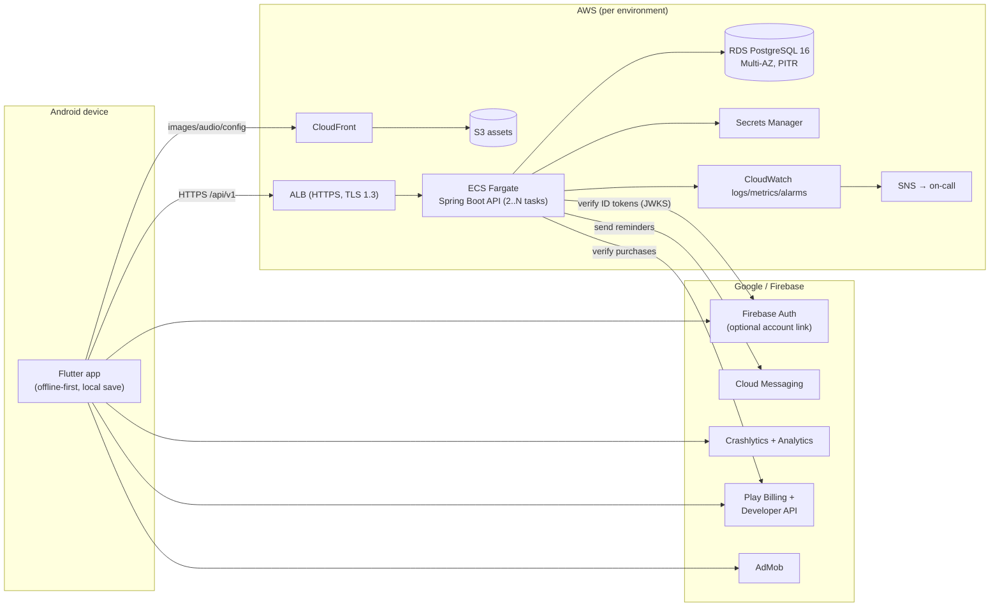
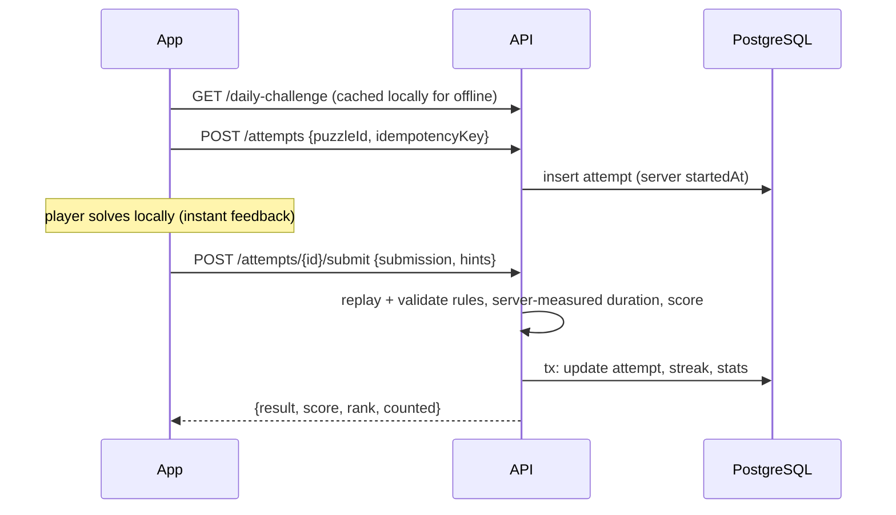

# Architecture

Quintile is a mobile-first daily mini-games hub: a Flutter app, a Spring Boot
**modular monolith**, and PostgreSQL as the transactional source of truth, hosted on
AWS managed services. The guiding rule (from the product spec): *add infrastructure
only when metrics justify it.*

The client/server contract — game rules, RNG, scoring, endpoints — lives in
[CONTRACT.md](CONTRACT.md) and is binding for both sides.

## System view

## Backend modules

One deployable, strict package boundaries (`com.puzzlehub.<module>`); modules talk via
public service interfaces, never each other's repositories. Any module can be extracted
later if a measured bottleneck or team boundary demands it.

| Module | Responsibility | Key tables |
|---|---|---|
| identity | guest accounts, JWT issue/refresh, Firebase account linking, deletion | `users`, `refresh_tokens` |
| catalog | game modes, versions, feature flags | `games` |
| puzzles | deterministic generators (Sudoku, Queens, Ladder, Merge) + curated Connect content, validators | `puzzles` |
| daily | publishes one immutable puzzle per game per UTC date, emergency replace | `daily_challenges` |
| attempts | attempt lifecycle, server-side replay/validation, scoring, idempotency | `attempts` |
| progress | opaque progress snapshots (optimistic concurrency), streaks, stats | `user_progress`, `streaks` |
| leaderboards | daily/weekly, global/country/friends, stable tie-breakers | derived from `attempts` (+ materialized aggregates when needed) |
| social | friend codes | `friendships` |
| economy | gem wallet ledger, daily login rewards, spend SKUs | `wallet_ledger`, `daily_rewards` |
| billing | Play purchase verification, entitlements (remove-ads, VIP) | `purchases`, `entitlements` |
| notifications | FCM tokens, reminder scheduling with quiet hours | `push_tokens` |
| admin | audited content operations (`ROLE_ADMIN`) | `audit_log` |

## Key flows

**Daily challenge.** A scheduled job pre-generates the next 7 days of challenges
(seeded by date, so regeneration is reproducible) and stores them as immutable,
checksummed puzzle versions. `GET /daily-challenge` is a cacheable read. A health check
logs `DAILY_CHALLENGE_MISSING` if today's set is absent; CloudWatch alarms on it (SEV-1).

**Play & submit.**

The client is untrusted: the server replays every submission (e.g. the full MERGE move
log against the seeded spawn RNG), measures time itself, and counts only the first
attempt per user/puzzle toward leaderboards.

**Offline.** Level packs are generated on-device from seeds; progress, coins and hearts
are local-first and backed up as a versioned snapshot (`PUT /me/progress`, 409 on stale
version → client merges max-stars per level). Gems and entitlements are
server-authoritative because they are paid for.

**Purchases.** Play Billing on device → `POST /purchases/google/verify` → server calls
the Play Developer API, grants exactly once per `purchaseToken` (unique constraint),
acknowledges the purchase, and records a ledger entry.

## Data & consistency rules

* UTC everywhere; daily reset 00:00 UTC.
* Flyway migrations; expand → migrate → contract across releases (no destructive
  migration in the same release as the code change).
* Unique constraints back every idempotency guarantee (`attempts(user_id, idempotency_key)`,
  `purchases(purchase_token)`, `daily_rewards(user_id, day)`).
* Puzzles are immutable; a broken daily is *replaced* (new version, audit entry), never edited.

## Scaling path

| Stage | Signals | Add | Not yet |
|---|---|---|---|
| MVP (now) | < 50 rps | 2 Fargate tasks, single RDS (Multi-AZ in prod), CloudFront | Redis, queues, k8s |
| Growth | p95 > 300 ms on leaderboard reads, DB CPU > 60% | Redis (ElastiCache) for leaderboard top-N + rate limiting, read replica for leaderboards/stats, materialized daily aggregates | microservices |
| Scale | > 1k rps, write contention on attempts | partition `attempts` by month, SQS for async scoring/notifications, autoscaling up to 30 tasks | split services without a bottleneck |
| Large | team/ownership boundaries | extract leaderboards + notifications as services | — |

Autoscaling already tracks CPU (60%) and ALB requests-per-target; Hikari pool size ×
max tasks must stay under RDS `max_connections` (alarm at 150).

## Infrastructure as code

`infra/terraform` — reusable modules (network, ecr, ecs_service, rds, secrets,
monitoring, static_assets, budget) composed by `modules/stack`, instantiated by
`envs/staging` and `envs/prod` (separate state, credentials and data). `bootstrap/`
creates the state bucket, lock table and GitHub OIDC roles (no long-lived AWS keys in CI).
Local development uses `infra/docker-compose.yml`.
